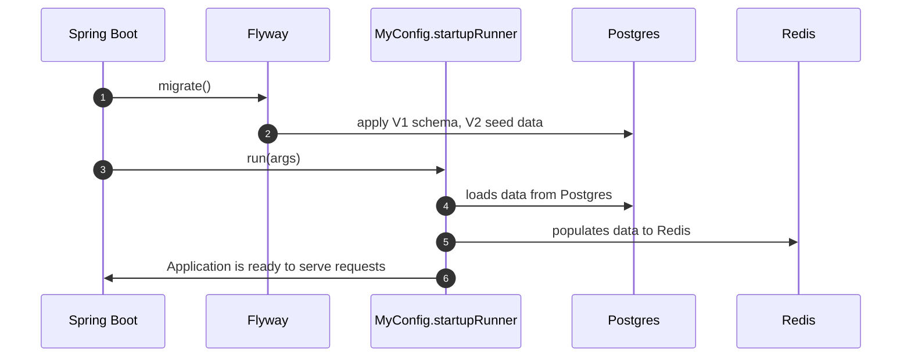
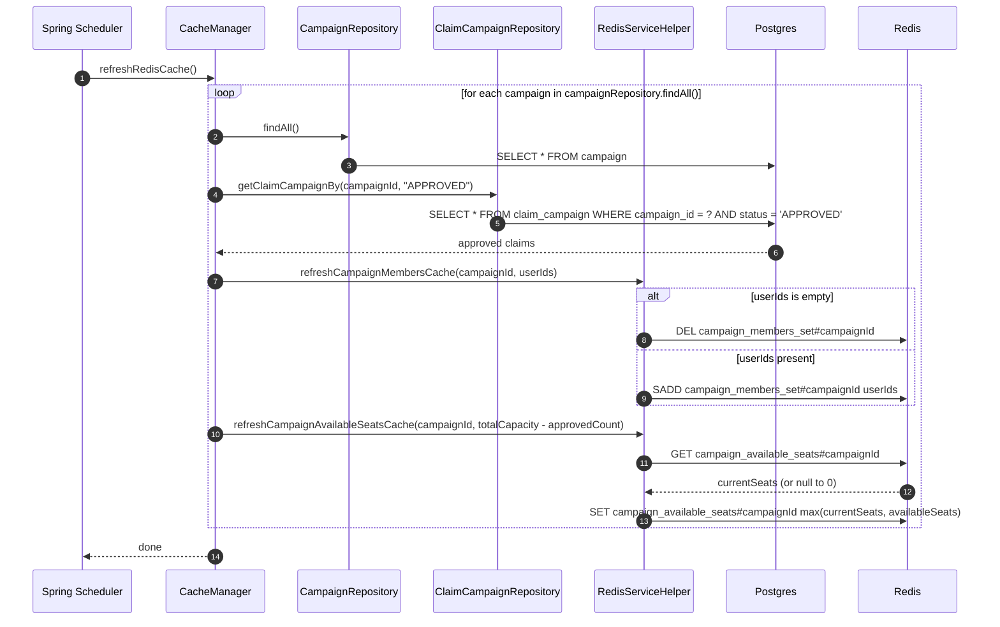
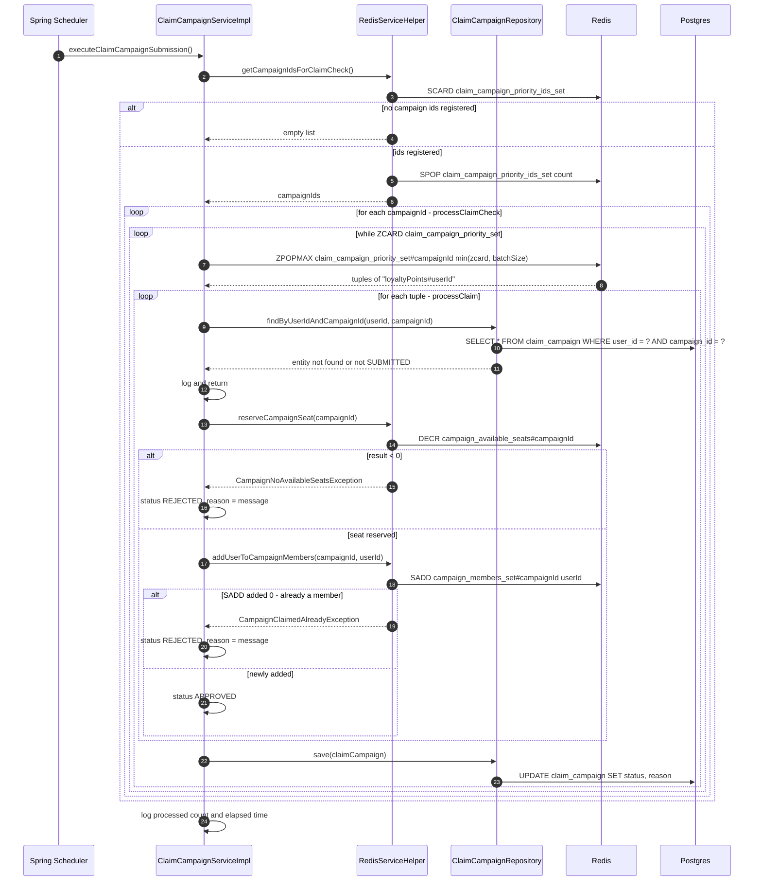
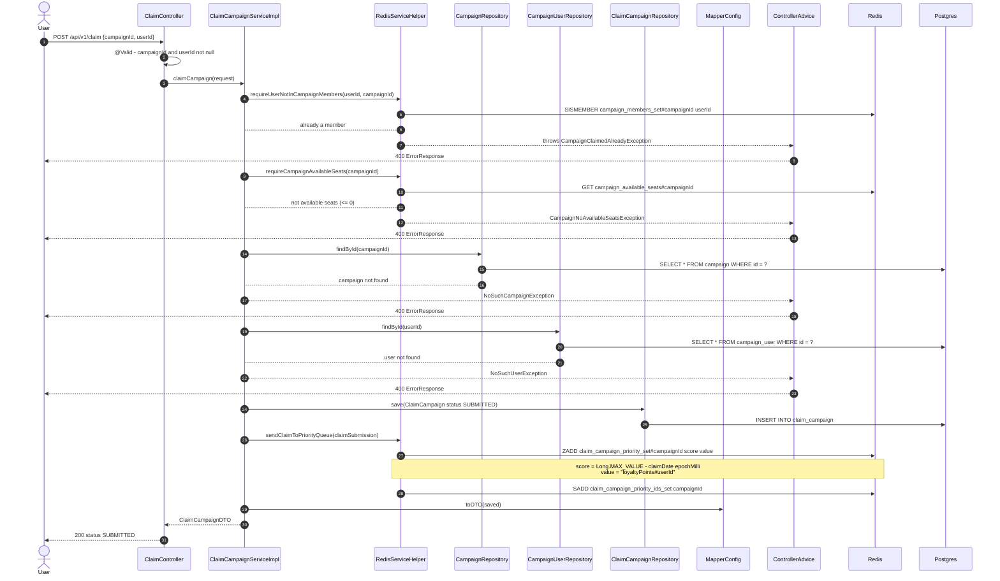
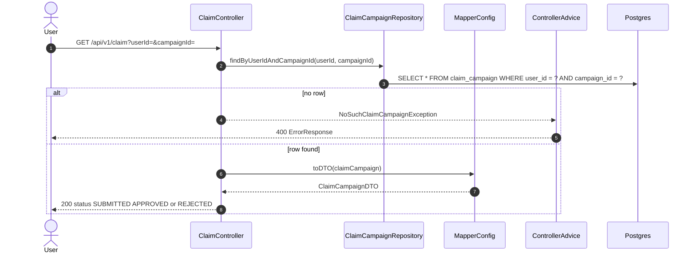
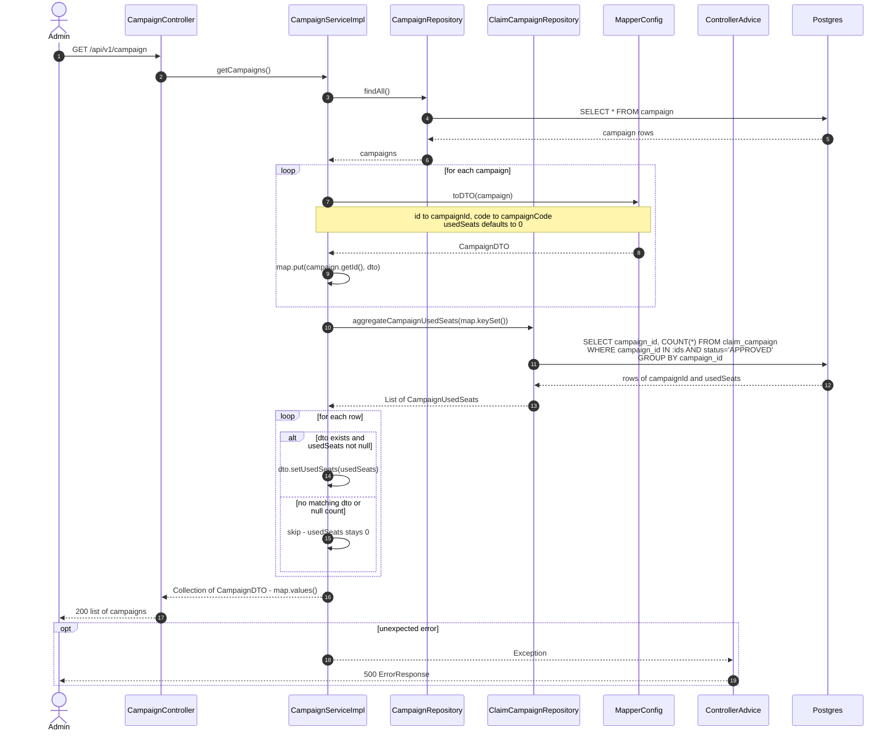
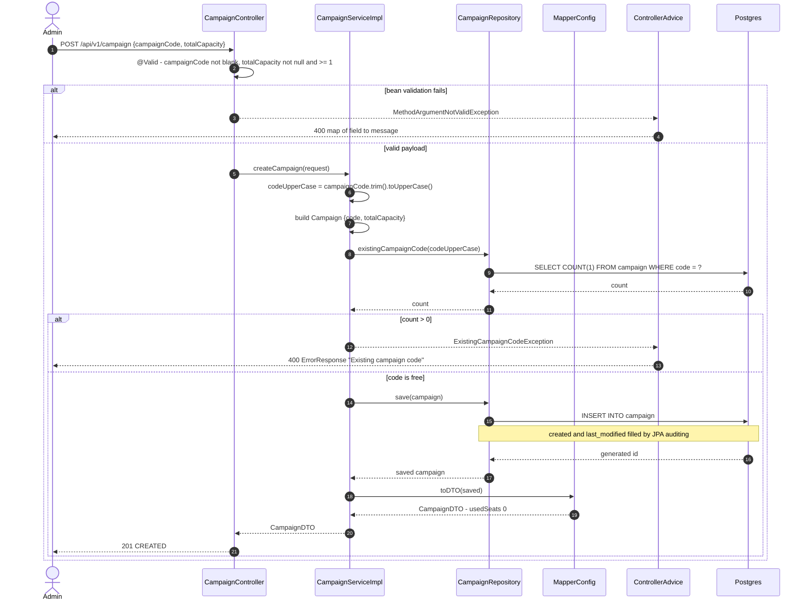

## 1. Application on startup

### 1. Flyway applies `db/migration/V1__create_tables.sql` and `V2__create_test_data.sql`.
### 2. The `com.demo.campaign.config.MyConfig.startupRunner` fulfills Redis from Postgres.



## 2. Scheduling Jobs

### 1. The `com.demo.campaign.service.CacheManager.refreshRedisCache` runs every 60 seconds to refresh Redis



### 2. The claim check job ```com.demo.campaign.service.ClaimCampaignServiceImpl.executeClaimCampaignSubmission``` 
- Runs every 5 seconds
- Turns `SUBMITTED` claims into `APPROVED` or `REJECTED` following in order: claim date -> loyalty points -> user id




## 3. `POST /api/v1/claim` - User requests a claim campaign

- Persists the claim as `SUBMITTED`, and enqueues it to Redis sorted set. The response is an acknowledgement, **not** a decision — approval happens later in the scheduled job.



## 4. `GET /api/v1/claim?userId=&campaignId=` - User polls the claim campaign status



## 5. `GET /api/v1/campaign` - Admin gets list of campaigns

- Read-only, Postgres only — no Redis is involved. `totalCapacity` comes from the `campaign` row, while `usedSeats` is aggregated on the fly by counting `APPROVED` claims.
- A campaign with no `APPROVED` claim gets no row from the aggregate query, so its `usedSeats` stays at the default `0`.



## 6. `POST /api/v1/campaign` - Admin creates a campaign

- The campaign code is trimmed and upper-cased before the uniqueness check, so `" summer "` and `"SUMMER"` collide.
- Nothing is written to Redis here. The `campaign_available_seats#{campaignId}` key is only created by the next `CacheManager.refreshRedisCache` run (up to 60 seconds later)


