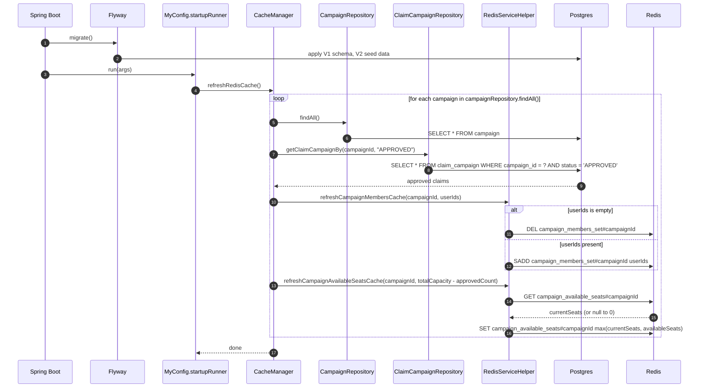
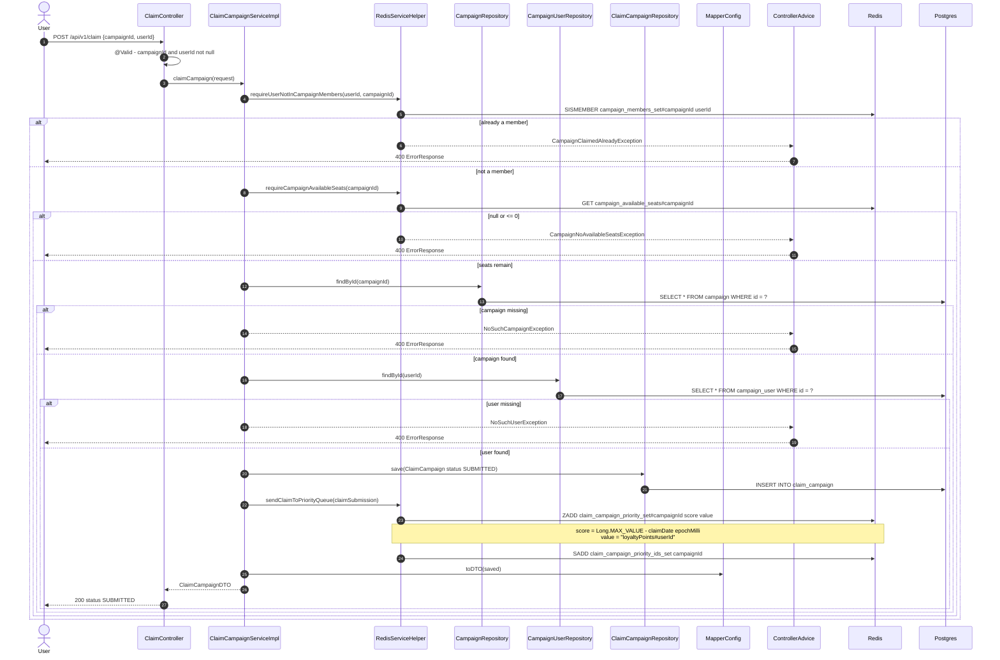
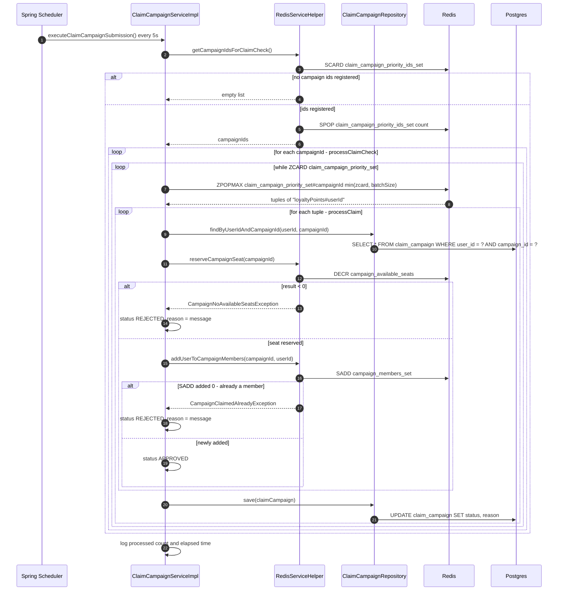
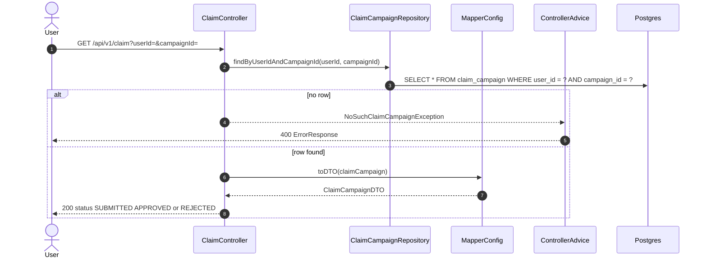

# Application on startup

Flyway applies `db/migration/V1__create_tables.sql` and `V2__create_test_data.sql`, then the
`startupRunner` `ApplicationRunner` bean in `MyConfig` warms Redis from Postgres. The same
`refreshRedisCache` method also runs every 60 seconds on a schedule.

`refreshCampaignAvailableSeatsCache` writes `max(current, recomputed)` instead of overwriting, so a
refresh that races with in-flight `DECR`s cannot silently hand out seats twice.

# User submits a claim campaign

`POST /api/v1/claim` performs cheap Redis guards, persists the claim as `SUBMITTED`, and enqueues it.
The response is an acknowledgement, **not** a decision — approval happens later in the scheduled job.

The guards at the start are fail-fast only; they read Redis without reserving anything. The binding
decision is made later, under `DECR`/`SADD`, so a claim that passes these checks can still be
rejected.

# Scheduled claim settlement

`ClaimCampaignServiceImpl.executeClaimCampaignSubmission` runs every 5 seconds
(`@Scheduled(fixedRate = 5000)`) and turns `SUBMITTED` claims into `APPROVED` or `REJECTED`.
Claims are drained with `popMax` against an inverted-timestamp score, so the **earliest** claim is
settled first. Tuple of loyalty_points#user_id in value to ensure if requests arrive simultaneously, 
the system should prioritize users with higher loyalty points.

Batch size comes from `redis.zset.batch-size` (default 100). A rejected claim does **not** give its
`DECR`-ed seat back; the counter is corrected by the next `refreshRedisCache` run, which recomputes
available seats from `APPROVED` rows in Postgres.

# Client polls the claim status

Because the decision is asynchronous, the caller polls. This endpoint reads the repository directly
rather than going through `ClaimCampaignService`.

